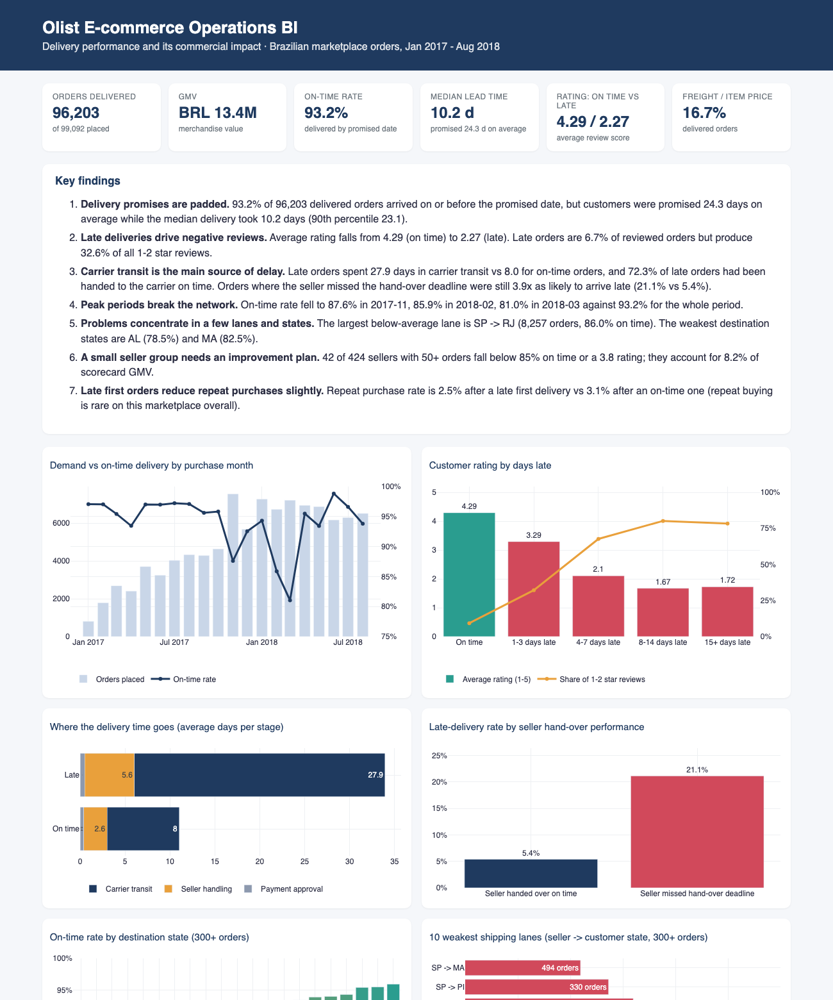
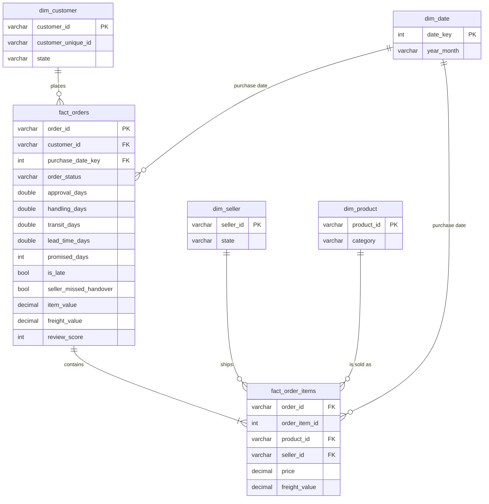

# Olist E-commerce Operations BI

**Delivery performance and its commercial impact on a Brazilian online marketplace.**
An end-to-end BI project: raw CSVs → DuckDB star schema → data-quality checks → SQL KPI layer → interactive dashboard, Excel KPI pack and business recommendations.

Author: **Oguzkagan Ilhan**. Industrial Engineer focused on supply chain and operations analytics, based in Cork, Ireland.



**Dashboard:** [`dashboard/index.html`](dashboard/index.html) is a self-contained page; open it in a browser, or view it via GitHub Pages.

---

## 1. Business problem

Olist connects small sellers to large Brazilian marketplaces. Sellers pack the goods and hand them to a carrier, and the customer is shown an estimated delivery date at checkout.
Operations leadership wants to know:

1. **Are we keeping our delivery promise**, and how accurate is the promise itself?
2. **What does a late delivery cost us** in customer ratings and repeat business?
3. **Where does lateness come from**: sellers, carriers, specific routes, or peak periods?
4. **Which sellers and lanes should we act on first?**

## 2. Data

- Olist public e-commerce dataset (official repository [olist/work-at-olist-data](https://github.com/olist/work-at-olist-data), CC BY-NC-SA 4.0).
- ~99k orders, 113k order items, 3k sellers, 33k products and 99k reviews, Sep 2016 to Oct 2018.
- **Analysis window: orders purchased Jan 2017 to Aug 2018.** 2016 holds only a few hundred test-phase orders. Orders from Sep and Oct 2018 were mostly still open when the snapshot was taken, so including them would bias delivery KPIs.

## 3. Data model

A star schema built in DuckDB SQL. Power BI or Tableau could consume the same tables directly.



| Layer | File | Purpose |
|---|---|---|
| Staging | `sql/01_staging.sql` | Typed copies of the raw files; deduplicates reviews to one per order |
| Dimensions | `sql/02_dimensions.sql` | Date, customer, seller and product (English category names) |
| Facts | `sql/03_facts.sql` | Order-level fact with lead-time stages and lateness flags; order-item fact |
| Data quality | `sql/04_data_quality.sql` | 7 blocking checks and 12 warnings → [`reports/data_quality.md`](reports/data_quality.md) |
| Analysis views | `sql/05_analysis_views.sql` | One shared scope so every KPI uses the same population |
| KPIs | `sql/kpis/*.sql` | 10 commented KPI queries; definitions in [`docs/kpi_dictionary.md`](docs/kpi_dictionary.md) |

## 4. Approach

1. **Profile and clean.** I checked row-count reconciliation, orphan keys, duplicates and timestamp consistency. Every blocking check passes. Known source issues are counted rather than silently dropped: for example, 1,358 orders show the carrier hand-over before payment approval, and 789 review IDs are shared across orders.
2. **Model.** Two fact tables at clearly defined grains, plus conformed dimensions.
3. **Define KPIs before charting them.** Each KPI has a business question, formula, grain and caveats in the [KPI dictionary](docs/kpi_dictionary.md).
4. **Decompose the problem.** I split lead time into approval, seller handling and carrier transit. Late orders are then classified by whether the seller met the carrier hand-over deadline, which is a root-cause split.
5. **Quantify impact.** Lateness is linked to customer ratings and repeat purchasing.
6. **Present.** An interactive dashboard, an Excel pack for business users, and recommendations.

## 5. Key findings

*All numbers below are generated by the pipeline (see [`reports/key_findings.md`](reports/key_findings.md)).*

1. **Delivery promises are padded.** 93.2% of 96,203 delivered orders arrived on or before the promised date. But customers were promised 24.3 days on average, while the median delivery took 10.2 days (90th percentile 23.1).
2. **Late deliveries drive negative reviews.** The average rating falls from 4.29 for on-time orders to 2.27 for late ones. Late orders are 6.7% of reviewed orders but produce 32.6% of all 1-2 star reviews.
3. **Carrier transit is the main source of delay.** Late orders spent 27.9 days in carrier transit vs 8.0 for on-time orders, and 72.3% of late orders had been handed to the carrier on time. Orders where the seller missed the hand-over deadline were still 3.9x as likely to arrive late (21.1% vs 5.4%).
4. **Peak periods break the network.** The on-time rate fell to 87.6% in 2017-11, 85.9% in 2018-02 and 81.0% in 2018-03, against 93.2% for the whole period.
5. **Problems concentrate in a few lanes and states.** The largest below-average lane is SP -> RJ (8,257 orders, 86.0% on time). The weakest destination states are AL (78.5%) and MA (82.5%).
6. **A small seller group needs an improvement plan.** 42 of the 424 sellers with 50+ orders fall below 85% on time or a 3.8 rating. They account for 8.2% of scorecard GMV.
7. **Late first orders reduce repeat purchases slightly.** The repeat purchase rate is 2.5% after a late first delivery vs 3.1% after an on-time one. Repeat buying is rare on this marketplace overall.

## 6. Recommendations

1. **Carrier performance management on the weakest high-volume lanes.** Most late orders were handed over on time and then stalled in transit (finding 3). Start with SP -> RJ, plus the Northeast destinations, through carrier SLAs, lane-level carrier scorecards and alternative carriers.
2. **Set delivery promises by lane, from actual lead-time percentiles.** Use something like the P90/P95 lead time per lane instead of a blanket buffer. Promises can then be shorter where the network is reliable, which helps conversion, and stay realistic where it is not (findings 1 and 5).
3. **Seller hand-over SLA and tiered seller management.** Alert sellers at D-1 before the shipping limit, and put the 42 tier-C sellers on improvement plans with clear targets. Missing the hand-over deadline makes lateness 3.9x more likely (findings 3 and 6).
4. **Peak-season readiness.** Plan carrier capacity ahead of Black Friday and the Feb-Mar period, where on-time fell to 81-86% (finding 4).
5. **Protect ratings when delays happen.** Notify customers about orders at risk and offer goodwill gestures. One-third of all negative reviews come from the 6.7% of orders that arrive late (finding 2).

## 7. How to run

```bash
python -m venv .venv && source .venv/bin/activate
pip install -r requirements.txt
python run_all.py        # download data -> build warehouse + DQ checks -> KPIs -> dashboard -> Excel
```

| Output | Description |
|---|---|
| `dashboard/index.html` | Interactive dashboard: KPI cards, findings and 8 charts |
| `reports/olist_kpi_pack.xlsx` | Formatted Excel pack: summary, monthly trend, seller scorecard, lanes, states, categories |
| `reports/kpis/*.csv` | Raw KPI results |
| `reports/data_quality.md` | Row counts and data-quality checks |
| `reports/key_findings.md` | Generated findings text |

The build fails if any blocking data-quality check fails, and every KPI query must return rows.

## 8. Skills demonstrated

- **Data modelling:** star schema design, fact grain definition, conformed dimensions
- **SQL:** CTEs, window functions, `FILTER` aggregates, percentiles, anti-joins for data-quality checks
- **Data quality:** reconciliation, orphan-key and duplicate checks, documented handling of bad timestamps
- **KPI design:** a KPI dictionary with definitions, grain and caveats
- **Root-cause analysis:** decomposing lead time and separating seller from carrier failures
- **Visualisation and reporting:** Plotly dashboard, formatted Excel pack for business users
- **Business communication:** findings tied to actionable recommendations

**Tools:** Python, DuckDB (SQL), pandas, Plotly, openpyxl.

## 9. Limitations

- The data is a public, anonymised sample from Brazil, so absolute numbers are illustrative of the method rather than benchmarks.
- The link between lateness and ratings is correlation; other factors may differ between late and on-time orders.
- Multi-seller orders (1.3% of delivered orders) count toward each of their sellers in seller and lane KPIs, because delivery dates are recorded per order.
- Seller tier thresholds are a deliberately simple starting point.

Data licence: see [DATA_LICENSE.md](DATA_LICENSE.md).
